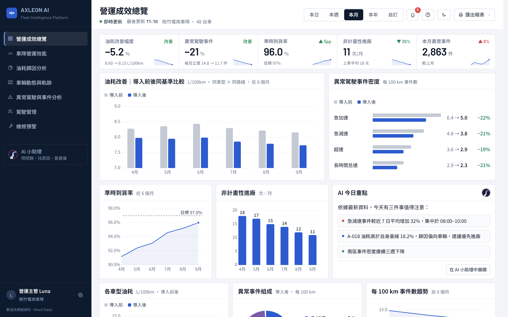
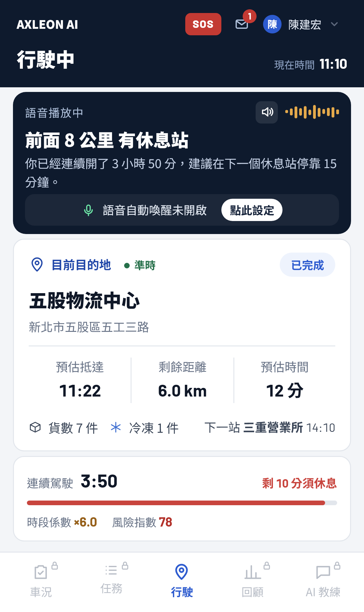

# AXLEON AI

商用車隊營運副駕。建立在 iTRAQ 既有車聯網資料之上，把異常數據轉成可執行的改善決策，零硬體增購。


2026 和泰 AI 黑客松 · HINO 企業挑戰題目「運用商用車車聯網大數據，發展商用車頭家的智慧夥伴」參賽作品。

本倉庫收錄專案說明與程式碼架構文件，不含原始碼。

## 目錄

- [示範影片](#示範影片)
- [系統概觀](#系統概觀)
- [要解決的問題](#要解決的問題)
- [設計取捨](#設計取捨)
- [技術選型](#技術選型)
- [專案結構](#專案結構)
- [文件](#文件)
- [資料來源與口徑](#資料來源與口徑)
- [驗證](#驗證)
- [部署](#部署)
- [授權](#授權)

## 示範影片

| | 情境 | 內容 |
|---|---|---|
| [Demo 1](https://drive.google.com/file/d/1x9Uab0v0S1sN1VjORKfppaSGwgnghr5L/view?usp=sharing) | 駕駛 | 行駛中語音提醒；休息點把整趟油耗拆解成具體駕駛動作 |
| [Demo 2](https://drive.google.com/file/d/1CfohnlQ6EjpBehGRz0EFJuNr1wLeFm-m/view?usp=sharing) | 調配主管 | 高風險貨單分級、改派建議工單與一鍵核准 |
| [Demo 3](https://drive.google.com/file/d/1rUzRPnsRRJOktHukZB3QITiwXstb5Tsa/view?usp=sharing) | 車隊經營者 | 單頁戰情報告與每月自動寄送的營運彙整報告 |

## 系統概觀

一次異常走完四個步驟：異常偵測 → 歸因分析 → 證據驗證 → 提出改善。三個端共用同一組資料、同一套指標定義、同一道檢核閘門。

| 端 | 使用者 | 功能 |
|---|---|---|
| 營運主管 Web | 調配主管 | 營運成效總覽、官方數據實證、車隊營運效能、影響因子分析、車輛動態與軌跡、異常駕駛與事件、駕駛支援、維修預警與工單、AI 小助理 |
| 駕駛 App（PWA） | 第一線駕駛 | 出車前檢點、行駛中語音播報、免持提問、任務管理、抵達與交貨、延誤通知、SOS、收工回顧 |
| 每月營運報告（Email） | 車隊經營者 | 不需登入系統，固定時間收到含執行摘要與完整分析的營運彙整報告 |


| 營運主管 Web | 駕駛 App（PWA） |
|---|---|
|  |  |

截圖中的營運數字為模擬資料（Mock Data），不代表任何真實車隊的營運成效。

## 要解決的問題

車況、駕駛與派車資訊都在 iTRAQ 裡，但分散在不同畫面與報表。異常發生時，主管必須交叉比對多項報表，判斷依賴個人經驗。結果是駕駛只收到月底排名，不知道該改什麼；主管看到警示，缺少完整判斷依據；經營者拿到成本總額時，已錯過介入時機。

AXLEON AI 要縮短「發現異常」到「採取行動」的時間，把月底檢討轉成日常主動管理。

## 設計取捨

### 依反應時間分流，只有最慢的一層用生成式 AI

| | 毫秒級 | 秒級 | 分鐘級 |
|---|---|---|---|
| 工作 | 連續駕駛計時、休息與延誤提醒 | 駕駛問一句、答一句 | 主管端歸因分析、每月報告 |
| 做法 | 裝置端規則判斷 | Gemini 2.5 Flash，限制 120 字 | Gemini 2.5 Pro，固定章節結構輸出 |
| 理由 | 法規門檻必須每次一致，不能等模型、不能因斷線漏掉 | 行駛中要的是一句話，不是完整推理 | 需綜合四類資料交叉判斷，允許較長推理 |

安全提醒留在規則層，是為了讓它在沒有網路或模型服務中斷時依然運作。

### 模型只轉譯，不計算

金額、百分比與車號一律由系統算好再交給模型。模型不接觸資料庫、不產生 SQL，能引用的範圍在取事實那一步就界定完畢。

### 未通過檢核的內容不會輸出

每則回答都要通過六道確定性檢核，逐字比對，不以模型審查模型。未通過即帶著錯誤處要求重寫一次；第二次仍不通過，改用規則式答案。細節見 [docs/ai-pipeline.md](docs/ai-pipeline.md)。

## 技術選型

| 環節 | 技術 | 選用理由 |
|---|---|---|
| 問題分類 | 規則式意圖路由（15 條） | 分類的正確答案固定。交給模型只會讓同一問題走到不同路徑，且每次付費 |
| 指標計算 | 自建語意層 Semantic Layer | 百公里油耗、時間加權怠速、同車型中位數偏差只定義一次，畫面、報表與 AI 共用 |
| 行車安全提醒 | 規則引擎，不經模型 | 連續駕駛與休息屬法規門檻，必須每次一致 |
| 主管端分析與月報 | Gemini 2.5 Pro | 需同時讀官方樣本、事件、維修與駕駛四類資料；月報以 responseSchema 固定章節輸出 |
| 駕駛端問答與語音 | Gemini 2.5 Flash | 一天可能提問上百次，延遲與成本比推理深度重要 |
| 語音辨識與播報 | Web Speech API（裝置端） | 行駛中須立即反應，錄音不離開手機 |
| 輸出品質控管 | 自建 Reviewer 檢核閘門 | 兩個模型可能犯同一類錯，逐字比對不會；判定結果可寫入稽核紀錄 |
| 資料儲存 | `node:sqlite`（Node 內建） | 單檔部署、無額外服務相依，WAL 模式支援讀寫並行 |
| 前端 | 單一 HTML 檔，無框架、無建置步驟 | 離線可用、載入快，部署面縮到最小 |

外購只有 Google Gemini 模型 API。語意層、Reviewer 檢核閘門、規則引擎、離線佇列、三端介面與報告流程皆為自建。

## 專案結構

```
axleon-system/
├── server/
│   ├── index.js              HTTP 路由與請求處理（51 個端點）
│   ├── services.js           語意層：指標的唯一定義處
│   ├── db.js                 SQLite 結構（18 張表）
│   ├── report.js             營運彙整報告組版、封存與寄送
│   ├── official-evidence.js  官方固定樣本讀取（唯讀）
│   ├── ai/                   AI 編排、意圖路由、Reviewer 檢核、語意層字典
│   └── tools/                smoke、ai-eval、官方資料匯入
├── public/
│   └── index.html            營運主管 Web 與駕駛 App 的單一來源
├── tools/
│   └── ui-regression.py      介面迴歸測試
├── Dockerfile
└── docker-compose.yml
```

逐檔職責、請求生命週期與環境變數見 [docs/architecture.md](docs/architecture.md)。

## 文件

| 文件 | 內容 |
|---|---|
| [architecture.md](docs/architecture.md) | 分層設計、模組職責、請求生命週期、降級路徑、環境變數 |
| [ai-pipeline.md](docs/ai-pipeline.md) | 四個關卡、意圖路由、模型參數、六道檢核、快取策略 |
| [data-model.md](docs/data-model.md) | 資料表、語意層口徑、來源三級標籤、官方樣本與分層驗證、資料限制 |
| [api.md](docs/api.md) | 51 個端點的介面與用途 |

## 資料來源與口徑

系統只使用 iTRAQ 既有欄位：時間、納管碼、行程識別碼、GPS 定位、車速、累積里程、累積油耗、carStatus、引擎負載、故障碼與 DMS 事件。

畫面上的每個數字都標示來源層級，三者不混算：

| 標籤 | 意義 |
|---|---|
| 官方實算 | 直接由主辦方競賽資料集計算，不可變動 |
| 情境估算 | 以官方樣本為基礎的推估，標明假設 |
| Demo Mock | 操作流程展示資料 |

官方樣本經清洗後為 20 台車、2,274 趟、27 個有效抽樣日。分車型計算後，怠速與油耗的相關為 HINO 300 +0.8929、500 +0.6658、700 −0.4403；跨車型的 +0.842 因此不能當成因果證據。這是系統只輸出查核優先序、不輸出責任占比的直接原因，也寫進了模型的系統指令與 Reviewer 檢核。

口徑定義與資料限制見 [docs/data-model.md](docs/data-model.md)。

## 驗證

| 工具 | 範圍 | 結果 |
|---|---|---|
| `smoke.js` | 登入、七個營運流程頁、官方資料唯讀口徑、SOS、工單排程與駕駛確認、訊息已讀與回覆、改派、教練指派、AI 小助理 | 19 / 19 |
| `ui-regression.py` | 主管端與駕駛端完整操作流程 | 63 / 63 |
| `ai-eval.js` | 官方數字、因果與排序、資料不足、隱私、示範與實證混用、估算邊界六類 | 50 / 50 |

日間／夜間模式 × 標準／大字級 × 八個畫面的文字對比度均通過 WCAG AA。

## 部署

單一 Docker 映像，無外部服務相依。執行環境為 Node.js ≥ 22.13 搭配內建 `node:sqlite`，資料存於單一資料卷。

未設定 `GEMINI_API_KEY` 時，AI 小助理以規則式回答，功能不中斷；模型或網路暫時不可用時亦自動降級。環境變數清單見 [docs/architecture.md](docs/architecture.md#設定)。

## 授權

本倉庫僅含說明文件，原始碼未公開，著作權由開發團隊保留。

文件引用的 iTRAQ 欄位說明與資料集統計結果，來源為 2026 和泰 AI 黑客松主辦單位提供之競賽資料。畫面截圖中的營運數字為模擬資料。

---

**智囊突擊隊** · 2026 和泰 AI 黑客松初賽 · 文件最後更新 2026-10-10
