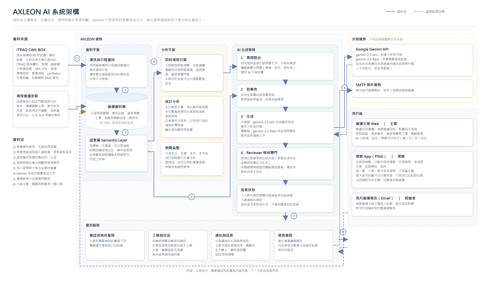

# AXLEON AI — 商用車隊營運副駕

> iTRAQ 讓車隊看見數據；AXLEON AI 讓管理者看懂原因、立即行動。

2026 和泰 AI 黑客松 · HINO 企業挑戰題目「運用商用車車聯網大數據，發展商用車頭家的智慧夥伴」參賽作品。

本倉庫為**專案說明與程式碼架構文件**，用於公開說明系統設計與技術選型，不包含原始碼。

---

## 這是什麼

一套建立在 iTRAQ 既有車聯網資料之上的車隊營運決策系統，**零硬體增購**。它不再多做一張儀表板，而是把「異常數據」轉成「改善決策」：

```
異常偵測  →  歸因分析  →  證據驗證  →  提出改善
```

系統同時服務三種角色，背後共用同一組資料、同一套指標定義、同一道檢核閘門：

| 端 | 使用者 | 做什麼 |
|---|---|---|
| **營運主管 Web** | 調配主管 | 營運成效總覽、官方數據實證、車隊營運效能、影響因子分析、車輛動態與軌跡、異常駕駛與事件、駕駛支援、維修預警與工單、AI 小助理 |
| **駕駛 App（PWA）** | 第一線駕駛 | 出車前檢點、行駛中語音播報、免持提問、任務管理、抵達與交貨、延誤通知、SOS、收工回顧 |
| **每月營運報告（Email）** | 車隊經營者 | 不需登入系統，固定時間收到含執行摘要與完整分析的營運彙整報告 |



---

## 要解決的問題

車況、駕駛與派車資訊都在 iTRAQ 裡，但分散在不同畫面與報表。異常發生時，主管必須交叉比對多項報表，判斷高度依賴個人經驗：

- **駕駛**只收到月底排名，不知道該改什麼
- **主管**看到警示，卻缺少完整判斷依據
- **經營者**拿到成本總額時，已錯過介入時機

AXLEON AI 要縮短「發現異常」到「採取行動」的時間，把月底檢討轉成日常主動管理。

---

## 設計上的三個主張

### 1. 三速分流：哪一段用 AI，哪一段刻意不用

越靠近方向盤的判斷，越不能依賴雲端。系統依反應時間把工作分成三層，只有最上層交給生成式 AI。

| | 毫秒級 | 秒級 | 分鐘級 |
|---|---|---|---|
| 做什麼 | 連續駕駛計時、休息與延誤提醒 | 駕駛問一句、答一句 | 主管端歸因分析、每月報告 |
| 怎麼做 | 裝置端規則判斷 | Gemini 2.5 Flash，限制 120 字 | Gemini 2.5 Pro，固定章節結構輸出 |
| 為什麼 | 法規門檻必須每次一致，不能等模型、不能因斷線漏掉 | 行駛中要的是一句話，不是完整推理 | 需綜合四類資料交叉判斷，允許較長推理 |

把安全提醒留在規則層，是為了讓它在沒有網路、模型服務中斷時依然運作。

### 2. 模型只負責轉譯，不負責計算

金額、百分比與車號一律由系統算好再交給模型。模型不接觸資料庫、不自行產生 SQL，能講的範圍在取事實那一步就被界定完畢。

### 3. 沒通過檢核的內容，不會出現在畫面上

每則 AI 回答都要通過一道確定性的 Reviewer 閘門（逐字比對，非以模型審查模型）。未通過即帶著錯誤處要求模型重寫一次；第二次仍不通過，改用規則式答案。

詳見 [docs/ai-pipeline.md](docs/ai-pipeline.md)。

---

## 技術選型

| 系統環節 | 採用技術 | 選用原因 |
|---|---|---|
| 問題分類 | 規則式意圖路由（15 條） | 分類的正確答案固定，交給模型只會讓同一問題得到不同路徑，且每次付費 |
| 指標計算 | 自建語意層 Semantic Layer | 百公里油耗、時間加權怠速、同車型中位數偏差只定義一次，畫面、報表與 AI 共用同一套口徑 |
| 行車安全提醒 | 規則引擎，不經模型 | 連續駕駛與休息屬法規門檻，必須每次一致 |
| 主管端分析與月報 | Gemini 2.5 Pro | 需同時讀官方樣本、事件、維修與駕駛四類資料才能下判斷；月報以 responseSchema 固定章節輸出 |
| 駕駛端問答與語音 | Gemini 2.5 Flash | 一天可能提問上百次，延遲與成本比推理深度重要 |
| 語音辨識與播報 | Web Speech API（裝置端） | 行駛中須立即反應，錄音不離開手機 |
| 輸出品質控管 | 自建 Reviewer 檢核閘門 | 不以模型審查模型：兩個模型可能犯同一類錯，逐字比對不會，且判定結果可寫入稽核紀錄 |
| 資料儲存 | `node:sqlite`（Node 內建） | 單檔部署、無額外服務相依；WAL 模式支援讀寫並行 |
| 前端 | 單一 HTML 檔，無框架、無建置步驟 | 離線可用、載入快、部署面縮到最小 |

**外購**：Google Gemini 模型 API
**自建**：語意層、Reviewer 檢核閘門、規則引擎、離線佇列、三端介面與報告流程

---

## 專案結構

```
axleon-system/
├── server/
│   ├── index.js              HTTP 路由與請求處理（約 45 個端點）
│   ├── http.js               請求／回應工具、JSON 解析、錯誤轉換
│   ├── auth.js               密碼雜湊驗證、簽章 Cookie、角色與登入節流
│   ├── config.js             環境變數集中處、模型路由、Session 金鑰
│   ├── db.js                 SQLite 連線與資料表定義（18 張表）
│   ├── services.js           語意層：指標唯一定義處，各頁資料組裝
│   ├── range.js              期間解析與區間換算（本日／週／月／年／自訂）
│   ├── report.js             營運彙整報告組版、封存與寄送
│   ├── official-evidence.js  官方固定樣本讀取（唯讀，不受示範資料影響）
│   ├── provenance.js         資料來源三級標籤（官方實算／情境估算／Demo Mock）
│   ├── scenario.js           情境估算試算
│   ├── live.js               模擬時鐘與即時狀態推進
│   ├── seed.js               示範資料建立
│   ├── util.js               共用小工具
│   ├── ai/
│   │   ├── index.js              AI 編排層：路由 → 取事實 → 生成 → 檢核 → 快取
│   │   ├── intents.js            15 條規則式意圖，含範圍外問題攔截
│   │   ├── answers.js            規則式答案與接地資料集（模型不可用時的降級路徑）
│   │   ├── llm.js                唯一呼叫模型的模組（Gemini provider）
│   │   ├── reviewer.js           七道確定性檢核閘門
│   │   ├── glossary.js           語意層字典，隨系統指令一併快取
│   │   └── report-analysis-v2.js 月報章節定義（規則式與模型路徑的唯一來源）
│   ├── official/hino-summary.json  官方樣本實算結果（由匯入工具產生）
│   └── tools/
│       ├── smoke.js          19 項端到端檢查
│       ├── ai-eval.js        50 題 AI 回答評估題庫
│       ├── import-hino.js    由官方資料集重算 hino-summary.json
│       └── add-user.js       建立帳號
├── public/
│   ├── index.html            營運主管 Web 與駕駛 App 的單一來源
│   └── architecture.html     系統架構圖
├── tools/
│   └── ui-regression.py      63 項介面迴歸測試
├── Dockerfile
└── docker-compose.yml
```

完整的模組職責、請求生命週期與資料流說明見 [docs/architecture.md](docs/architecture.md)。

---

## 資料來源與口徑

系統只使用 iTRAQ 既有欄位：時間、納管碼、行程識別碼、GPS 定位、車速、累積里程、累積油耗、carStatus、引擎負載、故障碼與 DMS 事件。

畫面上的每一個數字都標示來源層級：

| 標籤 | 意義 |
|---|---|
| **官方實算** | 直接由主辦方競賽資料集計算，不可變動 |
| **情境估算** | 以官方樣本為基礎的推估，標明假設 |
| **Demo Mock** | 操作流程展示資料，不與官方實算混算 |

官方樣本經清洗後為 20 台車、2,274 趟、27 個有效抽樣日。分車型計算後，怠速與油耗的相關為 HINO 300 **+0.8929**、500 **+0.6658**、700 **−0.4403**——跨車型的 +0.842 因此不能當成因果證據。這正是系統只輸出查核優先序、不輸出責任占比的原因。

口徑定義與資料限制見 [docs/data-model.md](docs/data-model.md)。

---

## 驗證

| 項目 | 範圍 | 結果 |
|---|---|---|
| `smoke.js` | 登入、七個營運流程頁、官方資料唯讀口徑、SOS、工單排程與駕駛確認、訊息已讀與回覆、改派、教練指派、AI 小助理 | 19 / 19 |
| `ui-regression.py` | 主管端與駕駛端完整操作流程 | 63 / 63 |
| `ai-eval.js` | 官方數字、因果與排序、資料不足、隱私、示範與實證混用、估算邊界六類 | 50 / 50 |

無障礙方面，日間／夜間模式 × 標準／大字級 × 八個畫面的文字對比度均通過 WCAG AA。

---

## 部署概要

單一 Docker 映像即可部署，無外部服務相依：

```
Node.js ≥ 22.13  ·  node:sqlite（內建）  ·  單一資料卷
```

未設定 `GEMINI_API_KEY` 時，AI 小助理以規則式回答，功能不中斷；模型或網路暫時不可用時亦自動降級。相關環境變數說明見 [docs/architecture.md](docs/architecture.md#設定)。

---

## 授權與使用範圍

本倉庫僅包含說明文件。原始碼未公開，著作權由開發團隊保留。

文件中引用的 iTRAQ 欄位說明與官方資料集統計結果，來源為 2026 和泰 AI 黑客松主辦單位提供之競賽資料；畫面截圖中的營運數字為模擬資料（Mock Data），不代表任何真實車隊的營運成效。

---

## 團隊

**智囊突擊隊** · 2026 和泰 AI 黑客松
